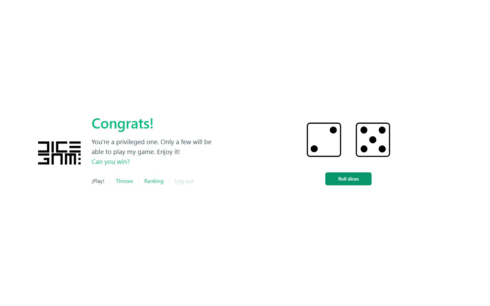
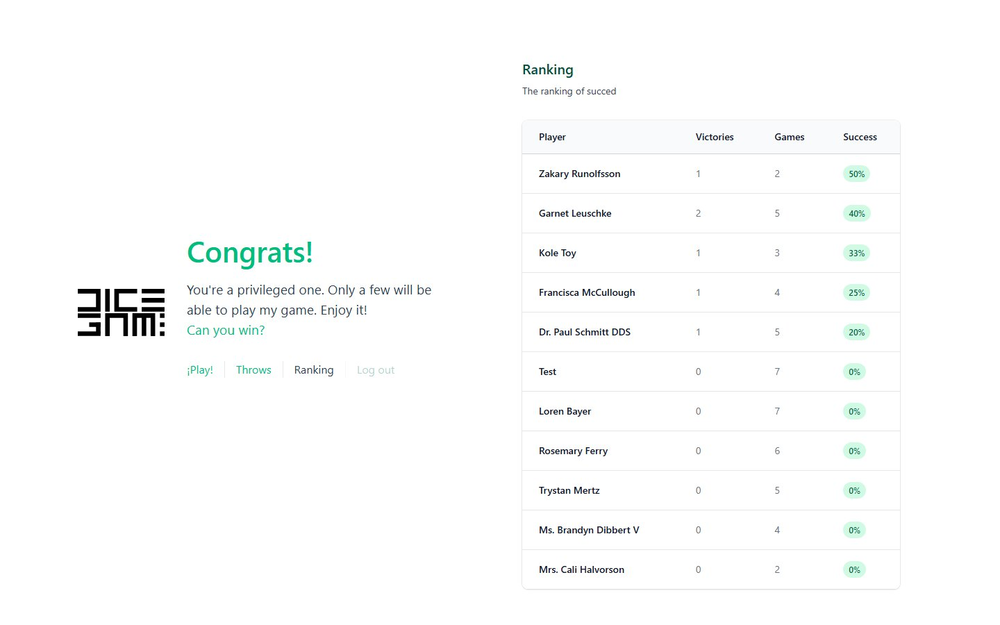
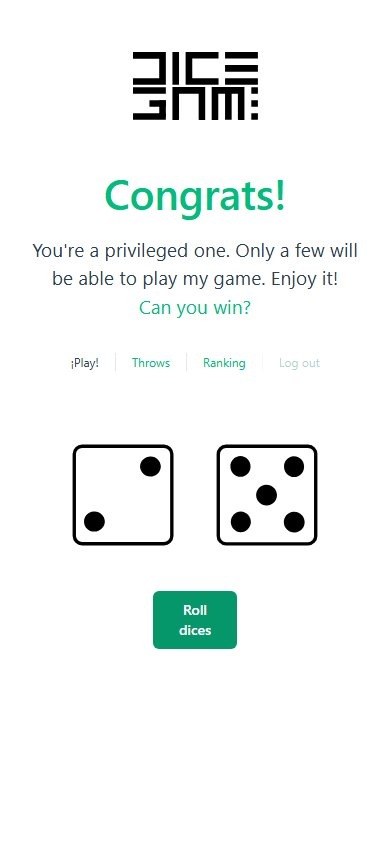

# Dice Game API

> A dice game with a REST API in Laravel and a Vue single-page client. You roll two dice and win when they add up to 7. Built in 2022-2023 as a Full Stack PHP bootcamp project (IT Academy); in 2026 it was tidied up and moved from Laravel 9 to Laravel 13 to run on current PHP.

[](https://github.com/wavesforweirdos/dices-api-rest/actions/workflows/ci.yml)



## Features

- Register and log in with a name (optional, `Anonymous` by default), email and password. Access is by personal access token ([Laravel Passport](https://laravel.com/docs/passport))
- Two roles with [spatie/laravel-permission](https://spatie.be/docs/laravel-permission): **Player** and **Admin**. A player can only see, rename and clear their own throws; an admin can do it for anyone and also sees the global statistics
- Roll the dice (`dice1 + dice2 = 7` is a win), see your throw history and delete it (single throws can't be deleted, only the whole history)
- Ranking of all players by success rate, plus the best and the worst player
- A Vue 3 client with vue-router, Vuex, Tailwind and Bootstrap, served by Laravel
- Throws are broadcast through Laravel Echo / Pusher (optional: `BROADCAST_DRIVER=log` in development)
- Responses use the HTTP status they report in the body (`401` for a forbidden action, `422` for invalid data)
- 35 feature and unit tests, run in CI on SQLite, and a Postman collection

| Ranking | On a phone |
|---|---|
|  |  |

## API

Everything lives under `/api`. All routes except register and login need `Authorization: Bearer <token>`.

| Method | Route | Who | What |
|---|---|---|---|
| `POST` | `/players` | anyone | Register a player; returns the user and an access token |
| `POST` | `/login` | anyone | Log in; returns the user and an access token |
| `POST` | `/logout` | player | Revoke the player's tokens |
| `PUT` | `/players/{id}` | owner, admin | Change a player's name |
| `POST` | `/players/{id}/games` | owner, admin | Roll the dice |
| `GET` | `/players/{id}/games` | owner, admin | List a player's throws |
| `DELETE` | `/players/{id}/games` | owner, admin | Delete all of a player's throws |
| `GET` | `/players/ranking` | any user | Success rate of every player |
| `GET` | `/players/ranking/winner` | any user | Player with the best rate |
| `GET` | `/players/ranking/loser` | any user | Player with the worst rate |
| `GET` | `/players` | admin | Every player with their games and success |
| `GET` | `/players/successRate` | admin | Average success rate of the whole game |

The Postman collection is in [`postman/`](postman/dices-api-rest.postman_collection.json): create a `token` variable (or paste a token from `/login`) before calling the protected routes.

## Technologies

| | |
|---|---|
| **Back end** | PHP 8.3+, [Laravel 13](https://laravel.com/), [Passport](https://laravel.com/docs/passport), [spatie/laravel-permission](https://spatie.be/docs/laravel-permission), MySQL |
| **Front end** | [Vue 3](https://vuejs.org/), vue-router, Vuex, Oruga UI, [Tailwind](https://tailwindcss.com/), Bootstrap, [Vite](https://vite.dev/) |
| **Real time** | Laravel Echo and [Pusher](https://pusher.com/) |
| **Quality** | PHPUnit 12 (35 tests), GitHub Actions |

## Getting started

You need PHP 8.3+ (it runs on 8.5, with the `sodium` extension enabled), Composer, Node 20+ and a MySQL database.

```sh
git clone https://github.com/wavesforweirdos/dices-api-rest
cd dices-api-rest
composer install
npm install

cp .env.example .env
php artisan key:generate
```

Edit `.env` with your database (`DB_*`) and, only if you want live broadcasting, your Pusher keys (`PUSHER_APP_*` and `BROADCAST_DRIVER=pusher`). Then:

```sh
php artisan migrate --seed      # tables, roles, an admin and ten players
php artisan passport:keys       # keys to sign the tokens
php artisan passport:client --personal --name="Dice Game Personal Access Client" --provider=users
php artisan serve               # API and client on http://localhost:8000
npm run dev                     # Vite with hot reload (or `npm run build`)
```

The seeder creates the admin `test@example.com` with the password `123456789`; change it if you ever publish the app.

The client calls `http://localhost:8000/api/` by default; set `VITE_API_URL` to point it somewhere else.

### Tests

```sh
vendor/bin/phpunit
```

`phpunit.xml` runs the tests on an in-memory SQLite database, so no MySQL server is needed.

| Script | Description |
|---|---|
| `npm run dev` | Vite dev server |
| `npm run build` | Production build into `public/build/` |

## Deployment

It needs a PHP host with a database, so it can't run on static hosting like GitHub Pages. Build the client (`npm run build`), set the production `.env` (`APP_ENV=production`, `APP_DEBUG=false`, `APP_URL` and database values) and run `php artisan migrate --force` and `php artisan passport:install`.

## Project layout

```
app/Http/Controllers/API/   Auth, Game and User controllers
app/Listeners/              CalculateRoll: decides win or loss
app/Models/                 User and Game
database/                   migrations, factories and seeders (roles included)
resources/js, views/        Vue client
routes/api.php              the routes above
tests/                      feature and unit tests
```
